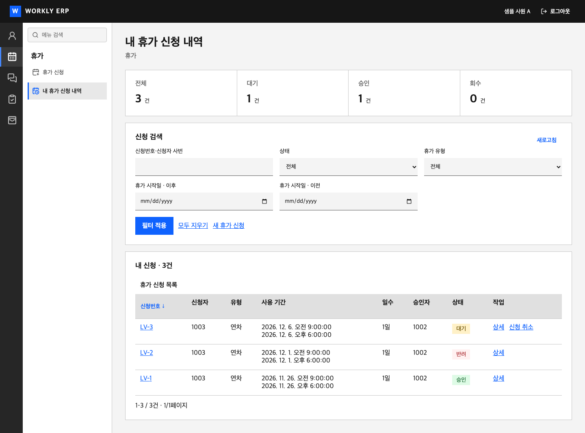
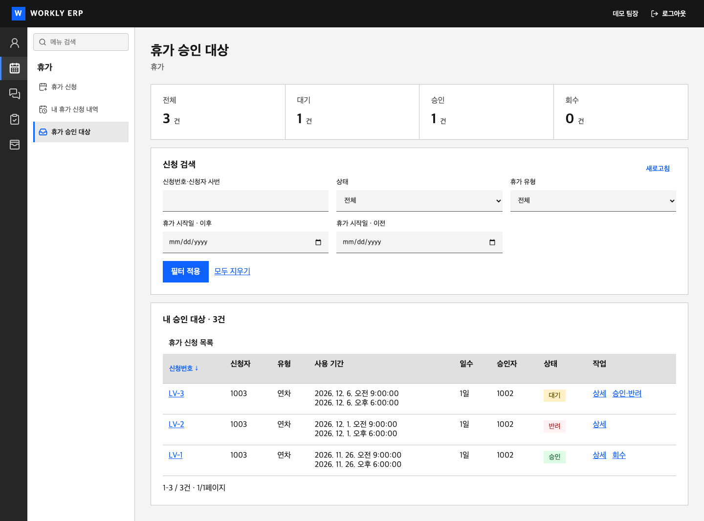
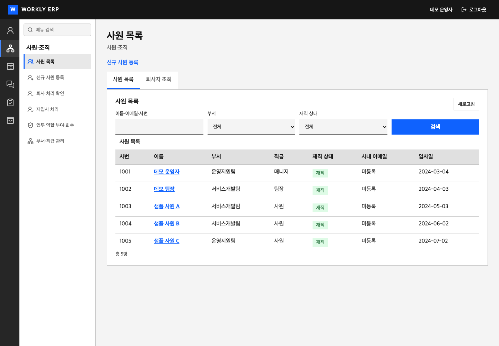
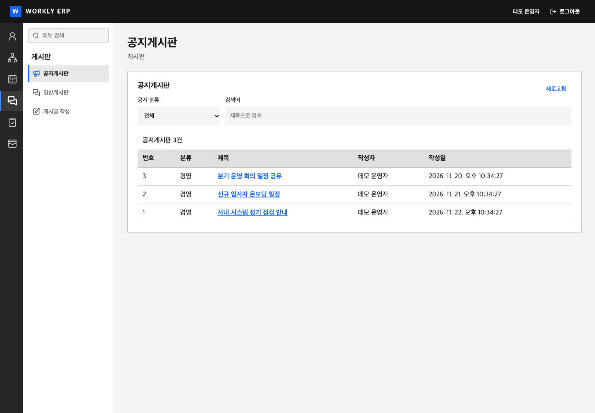

# WORKLY ERP · 인사 운영 그룹웨어

사원·조직, 휴가, 인사평가, 급여, 사내 공지를 한곳에서 관리하는 팀 프로젝트입니다. 직원은 본인의 업무 내역을 확인하고, 부서장과 인사 담당자는 역할에 따라 요청을 처리하고 변경 이력을 조회할 수 있습니다.

- **개발 기간** 2026년 8월 말 ~ 2026년 10월 초
- [Notion 프로젝트 문서](https://app.notion.com/p/ERP-3c98eced448d80b49c83fe465893ded9)

## 주요 화면

| 직원의 휴가 신청 내역 | 부서장의 휴가 승인 대상 |
| --- | --- |
|  |  |
| **사원·조직 관리** | **사내 공지** |
|  |  |

화면은 모의 데이터를 넣은 로컬 환경에서 Playwright로 캡처했습니다.

## 주요 기능

| 업무 | 제공 기능 |
| --- | --- |
| 사원·조직 | 입사·퇴사·재입사, 부서·직급 관리, 사원 역할 부여·회수, 인사발령 이력 |
| 휴가 | 잔여일수 조회, 신청·취소, 승인·반려·회수, 처리 이력 |
| 인사평가 | 평가 대상 조회, 평가 작성·제출·확정, 처리 이력 |
| 급여 | 급여명세 작성·확정·정정, 이력 조회, Excel 내보내기 |
| 게시판 | 일반 게시판, 공지게시판, 댓글과 역할별 작성·관리 |

## 팀 구성 및 기여

| 팀원               | 담당 및 구현                                                                                   |
| ---------------- | ----------------------------------------------------------------------------------------- |
| [김우진](https://github.com/Uhjinkim) (`Uhjinkim`) | 업무 도메인 경계와 Django 모듈 구조 설계, 휴가 신청·승인 화면과 잔여일수·이력 연동, 공통 디자인 시스템, 모듈 통합 및 AWS EC2 운영 환경 구성 |
| [김종윤](https://github.com/jyoun06) (`jyoun06`)  | 사원·조직과 내 정보, 입사·퇴사·재입사 및 인사발령 API, 개인정보 수정 요청                                             |
| [이소윤](https://github.com/sylee-0o0) (`sylee-0o0`) | 급여명세 화면과 처리 이력, 지급일과 급여 담당자 권한, 상태 필터                                                     |
| [장유안](https://github.com/UanaU) (`UanaU`)     | 일반 게시판과 공지게시판, 게시판별 번호와 댓글 수, 작성·수정·삭제 권한                                                 |
| [배재연](https://github.com/gitcobee) (`gitcobee`)    | 인사평가 화면과 대상 조회, 저장 실패 시 입력 유지, 본인 평가 처리 권한 제한                                             |

팀 개발은 완료했으며, 현재 유지보수는 [김우진](https://github.com/Uhjinkim)(`Uhjinkim`)이 담당합니다.

## 기술적으로 해결한 문제

- **업무 도메인 경계 설계** — 사원·조직, 휴가, 인사평가, 급여, 게시판을 각자의 업무 규칙을 가진 바운디드 컨텍스트로 나누고 Django 앱으로 매핑했습니다. 예를 들어 인사 모듈은 사원과 조직 정보를 관리하고, 휴가 모듈은 인사 게이트웨이에서 승인자 판단에 필요한 정보를 받아 신청과 승인 흐름을 처리합니다.
- **업무 규칙과 저장소 분리** — 사원·조직의 퇴사·재입사 조건, 휴가의 승인·회수 조건, 인사평가의 작성자·확정자 분리, 급여의 확정 조건, 게시글·댓글의 수정·삭제 권한을 순수 Python 도메인 코드로 구현했습니다. 이런 업무 처리 흐름에서 유스케이스는 도메인 규칙을 호출하고, 저장소 구현이 Django ORM으로 변경 사항을 저장합니다. [Django 모듈화 설계](docs/specs/notion/00-django-modularization.md)

## 기술 스택

Python 3.13 · Django 5.2 LTS · Django REST Framework · React 19 · TypeScript · Vite · Bun · PostgreSQL · Redis(개발) / Valkey(운영) · GitHub Actions · AWS EC2

## 개발 문서

[개발 환경 실행 안내](DEVELOPMENT.md) · [API 명세](docs/specs/notion/06-api-specification.md) · [테이블 명세](docs/specs/notion/08-table-specification.md) · [배포 가이드](docs/guides/aws-main-cicd.md)
