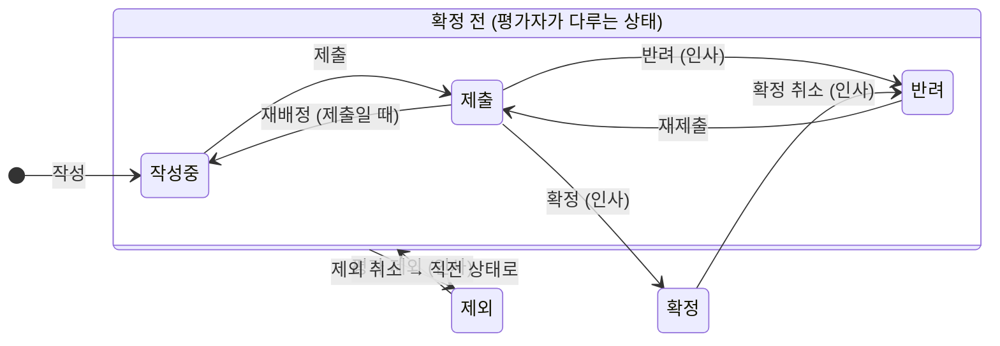

# 인사평가 페이지 사용 방법

- 대상: `evaluation` 모듈 화면(상단 탭 **인사평가**)
- 기준: `bae` 브랜치 구현 (`7d882a2`, dev 병합 완료)
- 작성: 2026-10-13
- 원본 문서: [Claude Docs](https://claude.ai/code/artifact/8e864d18-e0f1-40d6-ab3c-a26bc14cd79c)

## 개요

인사평가는 부서장이 부서원을 평가하고, 인사관리자가 검토·확정하며, 평가받은 사원은 확정된 결과만 조회하는
흐름입니다. 화면에서 보이는 내용과 쓸 수 있는 버튼은 직급이 아니라 아래 네 가지 역할로 정해집니다.

| 역할 | 누구 | 주로 하는 일 |
| --- | --- | --- |
| 일반 사원 | 평가를 받는 사원 | 확정된 내 평가 조회 |
| 부서장 | 각 부서의 부서장 | 부서원 평가 작성·수정·제출 |
| 인사관리자 | 인사관리자 권한을 가진 사원 | 반려·확정·확정 취소·제외·재배정 |
| 인사관리자 겸 부서장 | 예: 인사팀장 | 인사팀원 평가 작성 + 다른 평가 처리 |

**접속:** 로그인 후 상단 탭에서 **인사평가**를 누릅니다.

**화면 구성**

- 상단: 평가 연도 필터(전체·올해·작년·재작년), 새로고침 버튼
- 왼쪽: 평가 작성 폼(작성할 대상이 있는 부서장에게만 보임), 평가 목록
- 오른쪽: 목록에서 고른 평가의 상세, 수정·처리 영역, 처리 이력
- 안내·오류 메시지: 스크롤해도 화면 위쪽에 고정되어 보임

**평가 상태**

| 상태 | 뜻 | 수정할 수 있는 사람 |
| --- | --- | --- |
| 작성중 | 평가자가 쓰고 있음 | 평가자 |
| 제출 | 평가자가 제출, 인사관리자 검토 대기 | 없음 |
| 반려 | 인사관리자가 되돌림(확정 취소 포함) | 평가자 |
| 확정 | 최종 확정, 대상자에게 공개 | 없음 |
| 제외 | 평가 대상에서 뺌, 점수는 보존 | 없음 |

확정 전에는 반려·재제출을 오갈 수 있고, 확정된 평가는 확정 취소를 거쳐야만 다시 고칠 수 있습니다.

**등급:** 점수(0~100)로 자동 계산됩니다. S는 90점 이상, A는 80점 이상, B는 70점 이상, C는 70점 미만입니다.

## 일반 사원: 내 평가 조회

일반 사원은 **확정된 내 평가만** 볼 수 있고, 작성·수정·처리는 할 수 없습니다.

### 내 평가 보기

1. 로그인 후 **인사평가** 탭을 엽니다.
2. 왼쪽 **평가 목록**에서 내 평가를 누릅니다. 특정 연도만 보려면 상단 **평가 연도**를 바꿉니다.
3. 오른쪽 상세에서 점수, 등급, 평가 의견, 평가자, 기준 부서를 확인합니다.

### 알아두기

- 확정 전(작성중·제출·반려·제외) 평가는 목록에 나오지 않습니다. "표시할 평가가 없습니다"가 보이면 아직
  확정되지 않은 것입니다.
- 처리 이력(누가 언제 반려·확정했는지)은 볼 수 없습니다.
- 확정된 평가가 목록에서 사라졌다면 인사관리자가 확정을 취소해 정정 중인 것입니다. 다시 확정되면 나타납니다.
- 내가 인사관리자여도 내 평가는 확정 전에는 보이지 않습니다.

## 부서장(평가자): 평가 작성과 제출

부서장은 우리 부서원의 평가를 작성하고 제출합니다. 확정은 인사관리자가 합니다.

### 누구를 평가하나요

- 내가 부서장인 부서의 부서원
- 하위 부서의 부서장
- 목록에서 빠지는 사람: 본인, 퇴사자, 평가 기준일까지 근무 3개월 이하인 사원, 그 연도 평가가 이미 있는 사원
- 평가 기준일: 작년 평가는 작년 12월 31일, 올해 평가는 오늘. 작년 평가는 작년 12월 31일에 속했던 부서
  기준입니다.

### 평가 작성하기

1. **인사평가** 탭에서 왼쪽 **평가 작성** 폼을 찾습니다.
2. **평가 연도**(올해 또는 작년)를 고릅니다. 연도를 바꾸면 평가 대상 목록도 바뀝니다.
3. **평가 대상**을 고릅니다.
4. **점수(0~100)**와 **평가 의견**을 입력합니다. 점수는 소수점 둘째 자리까지 입력할 수 있습니다.
5. **작성중으로 저장**을 누릅니다. 상태는 `작성중`이 되고, 등급이 자동으로 붙습니다.

### 수정하기

1. 평가 목록에서 평가를 누릅니다.
2. 오른쪽 **평가 수정** 영역에서 점수·의견을 고치고 **저장**을 누릅니다.
3. `작성중`과 `반려` 상태에서만 수정할 수 있습니다.

### 제출하기

1. 수정을 끝낸 평가에서 **제출**을 누릅니다.
2. 상태가 `제출`이 되고 수정 영역이 사라집니다. 이후에는 인사관리자가 검토합니다.

### 반려됐을 때

1. 상태가 `반려`로 바뀝니다. 상세 아래 **처리 이력**에서 반려 사유를 확인합니다.
2. 사유에 맞게 수정하고 **저장** → **제출**합니다.
3. 확정된 평가를 인사관리자가 확정 취소한 경우에도 `반려`로 돌아오며, 같은 방법으로 정정합니다.

### 평가자가 바뀌었을 때(재배정)

- **새 평가자:** 목록에 평가가 나타납니다. 기존 점수·의견을 이어받아 확인·수정한 뒤 직접 제출합니다.
- **이전 평가자:** 목록에서 그 평가가 사라집니다.

### 할 수 없는 것

- 확정된 평가는 수정할 수 없습니다. 고쳐야 하면 인사관리자에게 확정 취소를 요청합니다.
- 같은 사원의 같은 연도 평가는 하나만 만들 수 있습니다.
- 부서장이 아니게 되면 작성·제출할 수 없고, 인사관리자가 다른 부서장에게 재배정해야 합니다.

## 인사관리자: 검토와 처리

인사관리자는 전체 평가를 보고 반려·확정·확정 취소·제외·재배정을 처리합니다. 평가 내용(점수·의견)은 고칠 수
없습니다.

### 평가 검토하기

1. **인사평가** 탭에서 전체 평가 목록을 봅니다. 상단 **평가 연도**로 걸러 볼 수 있습니다.
2. 평가를 누르면 오른쪽에 상세와 **처리 이력** 전체가 보입니다.
3. 상세 아래 **인사관리자 처리** 영역에 상태에 맞는 버튼이 나타납니다.

### 상태별 처리

| 처리 | 할 수 있는 상태 | 처리 사유 | 처리 후 상태 |
| --- | --- | --- | --- |
| 반려 | 제출 | 필수 | 반려 (평가자가 수정·재제출) |
| 확정 | 제출 | 없음 | 확정 (확정자에 내 이름) |
| 확정 취소 | 확정 | 필수 | 반려 (확정자 비워짐) |
| 평가 제외 | 작성중·제출·반려 | 필수 | 제외 (점수 보존) |
| 제외 취소 | 제외 | 선택 | 제외 직전 상태 |
| 평가자 재배정 | 작성중·제출·반려 | 필수 | 제출이었으면 작성중, 나머지는 그대로 |

처리 사유가 필수인데 비워 두고 누르면 "처리 사유를 입력하세요."가 뜨고 커서가 처리 사유 칸으로 이동합니다.

### 반려하기

1. `제출` 상태 평가를 엽니다.
2. **처리 사유**에 보완할 내용을 입력합니다.
3. **반려**를 누릅니다. 평가자가 처리 이력에서 사유를 보고 수정·재제출합니다.

### 확정하기

1. `제출` 상태 평가를 엽니다.
2. **확정**을 누릅니다. 확정자에 내 이름이 남고, 이때부터 평가 대상자가 결과를 볼 수 있습니다.
3. 그 평가를 작성·수정·제출한 적이 있는 사람은 확정할 수 없습니다. 다른 인사관리자가 확정합니다.

### 확정 취소(정정)하기

확정된 평가는 직접 고치지 않고, 확정 취소 → 평가자 정정 → 재확정 순서로 고칩니다.

1. `확정` 상태 평가를 열고 **처리 사유**에 정정 이유를 입력합니다.
2. **확정 취소**를 누릅니다. 상태는 `반려`, 확정자는 비워지고, 대상자 목록에서 사라집니다.
3. 평가자가 수정·제출하면 인사관리자가 다시 **확정**합니다. 처음과 다른 인사관리자가 확정해도 됩니다.

### 평가 제외·제외 취소

1. 확정 전 평가를 열고 **처리 사유**를 입력한 뒤 **평가 제외**를 누릅니다. 상태는 `제외`이고 점수는 보존됩니다.
2. `제외` 상태에서는 확정할 수 없습니다.
3. 되돌리려면 **제외 취소**를 누릅니다. 제외 직전 상태(작성중·제출·반려)로 돌아갑니다.

### 평가자 재배정하기

부서장이 바뀌거나 평가자가 평가할 수 없을 때 다른 부서장에게 평가를 넘깁니다.

1. 확정 전(작성중·제출·반려) 평가를 엽니다.
2. **처리 사유**에 재배정 이유를 입력합니다.
3. 아래 **새 평가자 (부서장)**에서 새 평가자를 고릅니다. 재직 중인 현재 부서장만 나오며, 현재 평가자와 평가
   대상자는 빠집니다.
4. **평가자 재배정**을 누릅니다. "평가자를 재배정했습니다."가 뜨고 현재 평가자가 바뀝니다.
5. `제출` 상태였다면 `작성중`으로 돌아가, 새 평가자가 내용을 확인하고 다시 제출합니다.

## 인사관리자 겸 부서장: 작성과 처리의 분리

인사팀장처럼 두 역할을 모두 가진 사원은 인사팀원 평가를 작성하고 다른 평가를 처리합니다. 단,
**본인이 작성한 평가는 다른 인사관리자가 처리**합니다.

### 평가 작성

- 부서장(평가자) 절과 같은 방법으로 작성·수정·제출합니다.

### 본인이 작성한 평가

- 반려·확정·평가 제외·평가자 재배정 버튼이 보이지 않습니다.
- 대신 "직접 작성한 평가는 반려·확정·제외·재배정을 다른 인사관리자가 처리합니다." 안내가 나옵니다.
- 제출한 뒤에는 다른 인사관리자에게 확정을 요청합니다.
- 재배정으로 평가자에서 빠진 뒤에도, 한 번 작성·수정·제출한 평가는 계속 처리할 수 없습니다.

### 다른 평가

- 인사관리자 절과 같은 방법으로 처리합니다.

미정: 본인이 작성한 평가의 **확정 취소·제외 취소**는 현재 막혀 있지 않으며, 허용 여부를 결정해야 합니다.

## 역할별 기능 한눈에 보기

| 기능 | 일반 사원 | 부서장 | 인사관리자 | 인사관리자 겸 부서장 |
| --- | --- | --- | --- | --- |
| 평가 작성 폼 | ✗ | ✓ | ✗ | ✓ |
| 목록에 보이는 평가 | 확정된 내 평가 | 내가 평가자인 평가 + 확정된 내 평가 | 전체 (확정 전 내 평가 제외) | 전체 (확정 전 내 평가 제외) |
| 처리 이력 보기 | ✗ | 내가 평가자인 평가 | ✓ | ✓ |
| 수정·제출 | ✗ | ✓ | ✗ | ✓ (내가 평가자인 평가) |
| 반려·확정·제외·재배정 | ✗ | ✗ | ✓ | ✓ (본인이 작성한 평가 제외) |
| 확정 취소·제외 취소 | ✗ | ✗ | ✓ | ✓ (미정) |

## 자주 묻는 질문과 오류 메시지

| 상황 또는 메시지 | 이유 | 해결 |
| --- | --- | --- |
| 부서장인데 평가 작성 폼이 없음 | 올해·작년 모두 작성할 대상이 없음(모두 평가가 있거나 3개월 이하) | 목록에서 기존 평가를 확인 |
| 평가 대상에 특정 사원이 없음 | 그 연도 평가가 이미 있거나, 기준일까지 근무 3개월 이하이거나, 다른 부서 소속 | 평가 연도를 확인하고, 필요하면 인사관리자에게 문의 |
| "처리 사유를 입력하세요." | 반려·확정 취소·제외·재배정은 사유가 필수 | 처리 사유 칸에 입력 후 다시 누름 |
| "해당 연도의 평가가 이미 존재합니다." | 한 사원의 같은 연도 평가는 하나뿐 | 목록에서 기존 평가를 열어 수정 |
| "작성중 또는 반려된 평가만 수정할 수 있습니다." | 제출·확정·제외 상태는 수정 불가 | 인사관리자에게 반려 또는 확정 취소를 요청 |
| "근무 기간이 3개월 이하인 사원은 평가 대상이 아닙니다." | 평가 기준일까지 3개월이 지나지 않음 | 대상 아님 |
| "평가를 작성한 사원은 해당 평가를 확정할 수 없습니다." | 본인이 작성·수정·제출한 평가 | 다른 인사관리자가 확정 |
| "평가를 작성한 사원은 해당 평가를 반려·제외·재배정할 수 없습니다." | 본인이 작성·수정·제출한 평가 | 다른 인사관리자가 처리 |
| "평가자는 현재 부서장이어야 합니다." | 부서장이 아닌 사원을 지정했거나, 평가자가 부서장 자리를 잃음 | 인사관리자가 현재 부서장에게 재배정 |
| 재배정 후 평가가 목록에서 사라짐 | 이전 평가자는 더 이상 볼 수 없음 | 정상 동작 |
| 확정된 내 평가가 사라짐 | 인사관리자가 확정 취소(정정 중) | 재확정되면 다시 보임 |
| "다른 사용자가 먼저 평가를 변경했습니다. 새로고침 후 다시 시도하세요." | 같은 평가를 다른 사람이 먼저 처리함 | **새로고침** 후 현재 상태를 보고 다시 처리 |
