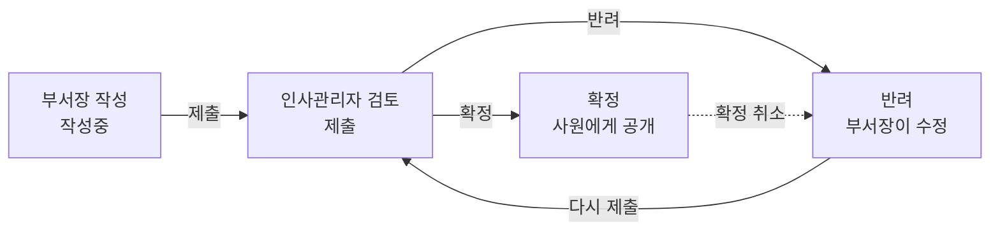

# 인사평가 사용 설명서

처음 인사평가를 쓰는 사람도 이 문서만 보고 따라 할 수 있도록, 화면에 보이는 문구와 버튼 이름 그대로 설명합니다.

- 대상 화면: WORKLY ERP > 인사평가 (팀 평가 대상 목록 · 평가 작성·수정 · 평가 관리·확정 · 내 평가 결과)
- 기준 버전: `bae` 브랜치 `15c7f44` (2026-10-13)
- 상태: 검토용 초안
- 이전 문서: [user-guide.md](./user-guide.md)는 화면을 나누기 전 구성 기준입니다.

## 목차

1. [먼저 알아 둘 것](#1-먼저-알아-둘-것)
2. [로그인하고 인사평가 열기](#2-로그인하고-인사평가-열기)
3. [화면 구성 익히기](#3-화면-구성-익히기)
4. [부서장: 평가 작성부터 제출까지](#4-부서장-평가-작성부터-제출까지)
5. [인사관리자: 검토하고 확정하기](#5-인사관리자-검토하고-확정하기)
6. [인사관리자 겸 부서장](#6-인사관리자-겸-부서장)
7. [모든 사원: 내 평가 결과 보기](#7-모든-사원-내-평가-결과-보기)
8. [예시: 평가 한 건이 확정되기까지](#8-예시-평가-한-건이-확정되기까지)
9. [이럴 땐 이렇게 (자주 묻는 질문)](#9-이럴-땐-이렇게-자주-묻는-질문)
10. [화면 메시지 사전](#10-화면-메시지-사전)
11. [용어 정리](#11-용어-정리)

---

## 1. 먼저 알아 둘 것

### 인사평가는 이렇게 진행됩니다

한 사원의 한 해 평가는 아래 순서로 진행됩니다.

1. **부서장**이 부서원의 점수와 의견을 작성합니다. (상태: `작성중`)
2. 부서장이 다 쓰고 **제출**합니다. (상태: `제출`)
3. **인사관리자**가 내용을 검토합니다.
   - 문제가 없으면 **확정**합니다. (상태: `확정`)
   - 보완이 필요하면 사유를 적어 **반려**합니다. (상태: `반려`) → 부서장이 고쳐서 다시 제출합니다.
4. 확정되면 **평가받은 사원**이 자기 결과를 볼 수 있습니다.



그 밖에 인사관리자는 필요할 때 **평가자를 다른 부서장으로 바꾸거나(재배정)**, **평가 대상에서 빼거나(제외)**, 확정된 평가를 **정정(확정 취소)**할 수 있습니다.

### 내 역할 확인하기

화면에 보이는 내용은 직급이 아니라 **역할**에 따라 달라집니다. 내 역할은 이렇게 확인할 수 있습니다.

| 내 상황 | 내 역할 | 주로 쓰는 화면 |
| --- | --- | --- |
| **팀 평가 대상 목록**에 평가할 사원이 나온다 | 부서장(평가자) | 팀 평가 대상 목록, 평가 작성·수정 |
| **평가 관리·확정**을 열면 평가 목록이 나온다 | 인사관리자 | 평가 관리·확정 |
| 둘 다 된다 | 인사관리자 겸 부서장 (예: 인사팀장) | 네 화면 모두 |
| 둘 다 안 된다 | 일반 사원 | 내 평가 결과 |

모든 사원은 **내 평가 결과**에서 확정된 자기 평가를 볼 수 있습니다.

### 꼭 알아 둘 규칙

- 한 사원의 **같은 연도 평가는 하나만** 만들 수 있습니다.
- 평가는 **올해와 작년** 것만 새로 만들 수 있습니다.
- **근무 3개월 이하**인 사원은 평가 대상이 아닙니다. 기준일은 작년 평가는 작년 12월 31일, 올해 평가는 오늘입니다.
- 점수는 **0~100점**, 소수점 **둘째 자리**까지 입력합니다. **등급은 자동**으로 계산됩니다.

| 등급 | 점수 |
| --- | --- |
| S | 90점 이상 |
| A | 80점 이상 90점 미만 |
| B | 70점 이상 80점 미만 |
| C | 70점 미만 |

예) 89.99점은 A, 90점은 S, 69.99점은 C입니다.

---

## 2. 로그인하고 인사평가 열기

1. 웹 브라우저(크롬·엣지 등 최신 버전)에서 ERP 주소로 접속합니다.
   - 개발 서버: `http://localhost:8080`
2. **업무 계정 로그인** 화면이 나옵니다.
   - **이메일**: 회사 이메일
   - **비밀번호**: 내 비밀번호
3. **로그인**을 누릅니다.
4. 화면 왼쪽 끝의 아이콘 줄에서 **인사평가** 아이콘(◫)을 누릅니다. 아이콘에 마우스를 올리면 이름이 보입니다.
5. 처음에는 **팀 평가 대상 목록** 화면이 열립니다.

> 동료에게서 받은 인사평가 주소(예: `…/#/evaluation/evaluation-hr?evalId=7`)로 바로 들어가도 됩니다.
> 로그인이 안 되어 있으면 로그인 화면이 먼저 나오고, 로그인하면 그 주소가 그대로 열립니다.

**로그아웃**은 화면 오른쪽 위의 **로그아웃** 버튼을 누릅니다. 다른 사람과 같은 컴퓨터를 쓴다면 꼭 로그아웃하세요.

---

## 3. 화면 구성 익히기

```
┌──────────────────────────────────────────────────────────────┐
│ WORKLY ERP                                  홍길동  로그아웃  │ ← 상단 막대
├────┬─────────────────┬───────────────────────────────────────┤
│ 홈 │ 인사평가        │ 팀 평가 대상 목록                     │ ← 화면 제목
│ …  │ [메뉴 검색    ] │ 인사평가                              │
│ ◫  │ ▶ 팀 평가 대상  │                                       │
│ …  │   평가 작성·수정│        (본문: 화면마다 다름)          │
│    │   평가 관리·확정│                                       │
│    │   내 평가 결과  │                                       │
└────┴─────────────────┴───────────────────────────────────────┘
 아이콘 줄  메뉴              본문
```

| 영역 | 설명 |
| --- | --- |
| 상단 막대 | 내 이름과 **로그아웃** 버튼 |
| 아이콘 줄 | 홈, 내 정보, 사원·조직, 휴가, 게시판, **인사평가**, 급여, 시스템 |
| 메뉴 | 인사평가의 네 화면. **메뉴 검색**에 글자를 입력하면 메뉴가 걸러집니다. 지금 보고 있는 메뉴가 강조됩니다. |
| 본문 | 위에 화면 제목이 있고, 그 아래에 내용이 나옵니다. |
| 서비스 연결 상태 | 본문 맨 아래. 서버와 연결이 끊기면 데이터를 불러오지 못합니다. |

화면 폭이 좁으면(태블릿·휴대폰) 메뉴가 접힙니다. 위쪽의 화면 메뉴 버튼을 눌러 펼치세요.

### 네 화면 한눈에 보기

| 메뉴 | 하는 일 | 누가 |
| --- | --- | --- |
| 팀 평가 대상 목록 | 평가할 사원 찾기, 내가 쓴 평가 모아 보기 | 부서장 |
| 평가 작성·수정 | 점수·의견 입력, 저장, 제출, 처리 이력 보기 | 부서장 |
| 평가 관리·확정 | 모든 평가 검토, 확정·반려·재배정·제외·확정 취소 | 인사관리자 |
| 내 평가 결과 | 확정된 내 평가 보기 | 모든 사원 |

### 평가 상태 표시

평가마다 상태가 색이 있는 표시(배지)로 나옵니다. 색만이 아니라 글자로도 적혀 있습니다.

| 상태 | 뜻 | 지금 누가 무엇을 하나 |
| --- | --- | --- |
| 작성중 | 부서장이 작성 중 | 부서장: 고치고 제출 |
| 제출 | 부서장이 제출함 | 인사관리자: 확정 또는 반려 |
| 반려 | 인사관리자가 되돌려 보냄 | 부서장: 사유를 보고 고친 뒤 다시 제출 |
| 확정 | 평가 완료, 사원에게 공개됨 | 고칠 일이 생기면 인사관리자가 확정 취소 |
| 제외 | 평가 대상에서 뺌 (점수는 남아 있음) | 인사관리자: 필요하면 제외 취소 |

---

## 4. 부서장: 평가 작성부터 제출까지

### 4-1. 평가할 사원 찾기 (팀 평가 대상 목록)

1. 메뉴에서 **팀 평가 대상 목록**을 누릅니다.
2. 맨 위 **평가 연도**에서 연도를 고릅니다. 올해와 작년 중 하나를 고를 수 있습니다.
3. **평가할 대상 · 2026** 카드에 평가할 수 있는 사원 표가 나옵니다.

   | 열 | 내용 |
   | --- | --- |
   | 이름 | 사원 이름 |
   | 사번 | 사원 번호 |
   | 부서 | 평가 기준일의 부서 번호 (예: 9120) |
   | 직급 | 직급 코드 (예: STAFF, SENIOR) |
   | 작업 | **평가 작성** 링크 |

4. 평가할 사원 줄의 **평가 작성**을 누르면 작성 화면으로 넘어갑니다.

**이 표에 나오는 사람**

- 내가 부서장인 부서의 부서원
- 내 부서 아래 하위 부서의 부서장

**이 표에 나오지 않는 사람**

- 나 자신
- 퇴사한 사원
- 그 연도 평가가 이미 있는 사원 (아래 **내가 평가자인 평가**에 있습니다)
- 평가 기준일까지 근무 3개월 이하인 사원
- 다른 부서 사원

> 작년 평가는 **작년 12월 31일에 속했던 부서** 기준입니다. 올해 1월에 다른 부서에서 옮겨 온 사원은 작년 평가 목록에 나오지 않을 수 있습니다.

아래 **내가 평가자인 평가** 카드에는 내가 작성했거나 넘겨받은 평가가 모두 나옵니다. 대상 이름을 누르면 그 평가가 열립니다.

| 열 | 내용 |
| --- | --- |
| 대상 | 평가받는 사원 (누르면 열림) |
| 연도 | 평가 연도 |
| 점수 / 등급 | 현재 점수와 자동 등급 |
| 상태 | 작성중·제출·반려·확정·제외 |
| 최근 변경 | 마지막으로 바뀐 날짜와 시간 |

### 4-2. 새 평가 작성하기

1. 팀 평가 대상 목록에서 **평가 작성**을 누르면 **평가 작성** 카드가 열립니다. 평가 연도와 평가 대상은 이미 선택되어 있습니다.
   - 메뉴의 **평가 작성·수정**을 바로 누른 경우에는 **평가 연도**와 **평가 대상**을 직접 고르세요.
   - 평가 연도를 바꾸면 평가 대상 목록이 그 연도 기준으로 바뀌고, 고른 대상은 다시 "선택하세요"가 됩니다.
2. **점수 (0~100)**에 점수를 입력합니다. 예) `85.5`
   - 입력칸 아래에 등급 기준 안내가 있습니다.
3. **평가 의견**에 의견을 적습니다. 비워 둬도 저장은 됩니다.
4. **작성중으로 저장**을 누릅니다.
5. 저장되면 그 평가의 수정 화면으로 바뀝니다. 주소 끝에 `?evalId=번호`가 붙습니다.
   - 상태는 `작성중`, 등급은 점수에 맞게 자동으로 표시됩니다.
   - 오른쪽 **처리 이력**에 "작성"이 기록됩니다.

> **저장해도 아직 제출된 것이 아닙니다.** `작성중` 상태에서는 몇 번이든 고칠 수 있고, 인사관리자는 검토하지 않습니다.

저장이 안 되면 카드 위쪽에 빨간 안내가 나오고, 문제가 있는 입력칸 아래에도 이유가 표시됩니다. [10. 화면 메시지 사전](#10-화면-메시지-사전)을 참고하세요.

### 4-3. 평가 열어서 고치기

1. **팀 평가 대상 목록** → **내가 평가자인 평가**에서 대상 이름을 누릅니다.
2. 왼쪽 카드 맨 위에 "이름 · 연도"와 상태 표시가 있습니다. 그 아래에 다음 정보가 나옵니다.

   | 항목 | 내용 |
   | --- | --- |
   | 점수 / 등급 | 저장된 점수와 등급 |
   | 현재 평가자 | 지금 이 평가를 맡은 부서장 |
   | 기준 부서 | 평가 기준일의 부서 번호 |
   | 확정 | 확정한 인사관리자 사번과 시간 (확정 전에는 "-") |

3. 아래 **점수 (0~100)**와 **평가 의견**을 고칩니다.
4. **저장**을 누르면 카드 안에 "저장했습니다."가 나오고, 처리 이력에 "수정"이 추가됩니다.

고칠 수 있는 때는 **상태가 `작성중` 또는 `반려`이고, 내가 현재 평가자일 때**뿐입니다. 그 밖의 경우에는 입력칸이 없고 "제출 상태에서는 수정할 수 없습니다."처럼 안내가 나옵니다.

### 4-4. 제출하기

평가를 다 썼으면 인사관리자에게 넘깁니다.

1. 평가 화면에서 **제출**을 누릅니다.
2. **평가를 제출할까요?** 확인 창이 열립니다.
   - "저장하지 않은 수정 내용도 함께 저장한 뒤 제출합니다."라는 설명이 있습니다. 방금 고친 내용을 따로 저장하지 않았어도 함께 저장됩니다.
3. 확인 창의 **제출**을 누릅니다. 그만두려면 **취소**나 오른쪽 위 **×**를 누르거나 Esc 키를 누르세요.
4. 상태가 `제출`로 바뀌고 "평가를 제출했습니다."가 나옵니다. 입력칸은 사라집니다.

> 제출한 뒤에는 고칠 수 없습니다. 고쳐야 하면 인사관리자에게 **반려**를 요청하세요.

### 4-5. 반려된 평가 다시 제출하기

인사관리자가 보완을 요청하면 평가가 `반려` 상태로 돌아옵니다.

1. **팀 평가 대상 목록** → **내가 평가자인 평가**에서 상태가 `반려`인 평가를 엽니다.
2. "반려된 평가입니다. 처리 이력의 사유를 확인하고 수정한 뒤 다시 제출하세요." 안내가 보입니다.
3. 오른쪽 **처리 이력**에서 가장 아래쪽 **반려** 줄의 **사유**를 읽습니다.
4. 사유에 맞게 점수·의견을 고칩니다.
5. **제출** → 확인 창의 **제출**을 누릅니다.

확정된 평가를 인사관리자가 **확정 취소**한 경우에도 `반려` 상태로 돌아오며, 고치는 방법은 같습니다. 처리 이력의 "확정 취소" 사유를 확인하세요.

### 4-6. 평가자가 바뀌었을 때 (재배정)

인사관리자가 평가를 다른 부서장에게 넘기면 다음과 같이 됩니다.

- **새로 맡은 부서장**
  - **내가 평가자인 평가**에 그 평가가 나타납니다.
  - 열어 보면 이전 평가자가 쓴 점수와 의견이 그대로 있습니다.
  - 내용을 확인하고 필요하면 고친 뒤 직접 **제출**합니다. 제출 상태였던 평가는 재배정되면 `작성중`으로 돌아오기 때문에 다시 제출해야 합니다.
- **이전 부서장**
  - 목록에서 사라집니다.
  - 예전 주소로 열면 "평가를 찾을 수 없습니다."가 나옵니다. 정상입니다.

### 4-7. 처리 이력 읽는 법

평가 화면 오른쪽 **처리 이력**에는 이 평가에 일어난 일이 순서대로 쌓입니다. 아래로 갈수록 최근 일입니다.

```
작성
한서준 · 2026. 10. 13. 오후 6:47
반려
이서연 · 2026. 10. 13. 오후 6:49
사유: 근거 사례를 보완해 주세요
평가자 재배정
이서연 · 2026. 10. 13. 오후 6:52
평가자 910011 → 910038
사유: 부서장 교체
```

- 첫 줄: 한 일 (작성, 수정, 제출, 반려, 확정, 확정 취소, 평가자 재배정, 평가 제외, 제외 취소)
- 둘째 줄: 한 사람 · 날짜와 시간
- 사유가 있으면 "사유:"로, 재배정이면 "평가자 이전 사번 → 새 사번"으로 표시됩니다.

처리 이력은 **현재 평가자와 인사관리자만** 볼 수 있습니다.

---

## 5. 인사관리자: 검토하고 확정하기

### 5-1. 평가 관리·확정 화면 열기

1. 메뉴에서 **평가 관리·확정**을 누릅니다.
2. 인사관리자가 아니면 "인사관리자만 사용할 수 있는 화면입니다"가 나옵니다.

화면 구성:

- 맨 위: **평가 연도** (전체 · 올해 · 작년 · 재작년), **새로고침** 버튼
- 왼쪽: 상태 탭과 평가 목록
- 오른쪽: 고른 평가의 상세와 처리 이력. 아직 고르지 않았으면 "목록에서 평가를 선택하세요"가 나옵니다.

### 5-2. 검토할 평가 찾기

1. **평가 연도**로 연도를 고릅니다. 전체를 보려면 "전체"를 고릅니다.
2. 상태 탭을 누릅니다. 탭에 건수가 함께 나옵니다. 예) `제출 3`
   - 확정을 기다리는 평가: **제출** 탭
   - 부서장이 고치고 있는 평가: **반려** 탭
   - 탭은 키보드 ←/→ 화살표로도 옮길 수 있습니다.
3. 표의 **대상** 이름을 누르면 오른쪽에 상세가 열립니다. 고른 줄은 배경색이 바뀝니다.

| 열 | 내용 |
| --- | --- |
| 대상 | 평가받는 사원 (누르면 상세) |
| 연도 | 평가 연도 |
| 평가자 | 현재 평가자 |
| 점수·등급 | 예) 89.99 · A |
| 상태 | 작성중·제출·반려·확정·제외 |

> 상세를 연 상태의 주소(`…evaluation-hr?evalId=7`)를 복사해 동료에게 보내면 같은 평가가 바로 열립니다.

여러 인사관리자가 동시에 일한다면, 처리하기 전에 **새로고침**을 눌러 최신 상태를 확인하세요.

### 5-3. 상세에서 확인할 내용

오른쪽 카드에는 다음 내용이 있습니다.

- 제목: "대상 이름 · 연도"와 상태 표시
- **점수·등급**, **현재 평가자**, **기준 부서**, **확정**(확정자 사번과 시간)
- 평가 의견 본문
- 상태에 맞는 처리 버튼
- 아래 **처리 이력**: 누가 언제 무엇을 했는지와 사유

버튼은 **지금 상태에서 할 수 있는 것만** 나옵니다.

| 상태 | 나오는 버튼 |
| --- | --- |
| 작성중 | 평가자 재배정, 평가 제외 |
| 제출 | 확정, 반려, 평가자 재배정, 평가 제외 |
| 반려 | 평가자 재배정, 평가 제외 |
| 확정 | 확정 취소 |
| 제외 | 제외 취소 |

처리를 마치면 카드 안에 결과 문구(예: "평가를 확정했습니다.")가 나오고, 왼쪽 목록과 탭 건수도 바로 바뀝니다.

### 5-4. 확정하기

부서장이 제출한 평가에 문제가 없을 때 합니다.

1. **제출** 탭에서 평가를 엽니다.
2. 점수·등급과 의견을 검토합니다.
3. **확정**을 누릅니다.
4. **평가를 확정할까요?** 확인 창에서 **확정**을 누릅니다.
5. 상태가 `확정`이 되고, **확정** 항목에 내 사번과 시간이 기록됩니다.
6. 이때부터 평가받은 사원이 **내 평가 결과**에서 결과를 볼 수 있습니다.

> 그 평가를 **직접 작성·수정·제출한 적이 있는 사람은 확정할 수 없습니다.** 다른 인사관리자가 확정합니다. ([6절](#6-인사관리자-겸-부서장) 참고)

### 5-5. 반려하기

보완이 필요할 때 부서장에게 되돌려 보냅니다.

1. **제출** 상태 평가를 엽니다.
2. **반려**를 누르면 **평가 반려** 창이 열립니다.
3. **처리 사유**에 무엇을 보완해야 하는지 구체적으로 적습니다. 최대 255자입니다.
   - 예) "3분기 프로젝트 성과 근거를 의견에 추가해 주세요."
4. 창의 **반려**를 누릅니다.
5. 상태가 `반려`가 되고, 부서장은 처리 이력에서 이 사유를 보고 수정합니다.

사유를 비운 채 **반려**를 누르면 창 안에 "처리 사유를 입력하세요."가 나오고 창이 닫히지 않습니다.

### 5-6. 확정된 평가 정정하기 (확정 취소)

확정된 평가는 직접 고칠 수 없습니다. 아래 순서로 정정합니다.

1. **확정** 탭에서 평가를 열고 **확정 취소**를 누릅니다.
2. **확정 취소** 창의 **처리 사유**에 정정 이유를 적습니다. 예) "점수 입력 오류 정정"
3. 창의 **확정 취소**를 누릅니다.
   - 상태가 `반려`로 바뀌고 확정 정보가 지워집니다.
   - 평가받은 사원의 **내 평가 결과**에서 이 평가가 잠시 사라집니다.
4. 부서장에게 수정·재제출을 요청합니다. ([4-5](#4-5-반려된-평가-다시-제출하기))
5. 다시 제출되면 [5-4 확정하기](#5-4-확정하기)로 다시 확정합니다. 처음 확정한 사람이 아니어도 됩니다.

### 5-7. 평가자 재배정하기

부서장이 바뀌었거나 평가자가 평가할 수 없을 때 다른 부서장에게 넘깁니다.

1. **작성중·제출·반려** 상태 평가를 엽니다. 확정·제외된 평가는 재배정할 수 없습니다.
2. **평가자 재배정**을 누르면 **평가자 재배정** 창이 열립니다.
3. **새 평가자 (부서장)**에서 넘길 사람을 고릅니다.
   - "이름 (사번) · 부서명" 형식으로 나옵니다.
   - 재직 중인 **현재 부서장**만 나오며, 지금 평가자와 평가받는 사원은 빠져 있습니다.
4. **처리 사유**를 적습니다. 예) "개발팀장 교체로 재배정"
5. 창의 **재배정**을 누릅니다.
6. **현재 평가자**가 바뀝니다. `제출` 상태였다면 `작성중`으로 돌아가고, 새 평가자가 확인한 뒤 다시 제출합니다.

평가자를 고르지 않으면 "새 평가자를 선택하세요.", 사유가 없으면 "처리 사유를 입력하세요."가 창 안에 나옵니다.

### 5-8. 평가 제외하기 / 제외 취소하기

장기 휴직 등으로 평가하지 않기로 했을 때 씁니다. 점수를 0점으로 바꾸는 것과 달리, **원래 점수와 의견은 그대로 남습니다.**

**제외하기**

1. **작성중·제출·반려** 상태 평가를 엽니다.
2. **평가 제외**를 누르고, 창의 **처리 사유**를 적습니다. 예) "장기 휴직으로 평가 제외"
3. 창의 **평가 제외**를 누릅니다. 상태가 `제외`가 됩니다.

제외된 평가는 확정할 수 없습니다.

**제외 취소하기**

1. **제외** 탭에서 평가를 엽니다.
2. **제외 취소**를 누릅니다. 처리 사유는 적어도 되고 비워도 됩니다.
3. 창의 **제외 취소**를 누르면 제외하기 **직전 상태**(작성중·제출·반려)로 돌아갑니다.

### 5-9. 창 다루기

- 처리 창이 열려 있는 동안에는 뒤쪽 화면을 누를 수 없습니다.
- 그만두려면 **취소**, 오른쪽 위 **×**, 또는 Esc 키를 누릅니다.
- 처리 중(버튼에 도는 표시가 있을 때)에는 창을 닫을 수 없습니다. 잠시 기다리세요.
- 버튼은 처리 중에 눌리지 않으므로 두 번 처리될 걱정은 없습니다.

---

## 6. 인사관리자 겸 부서장

인사팀장처럼 **부서장이면서 인사관리자**인 사람은 두 가지 일을 모두 합니다.

- 부서장으로서: 인사팀원을 평가합니다. ([4절](#4-부서장-평가-작성부터-제출까지)과 같음)
- 인사관리자로서: 다른 평가를 검토·처리합니다. ([5절](#5-인사관리자-검토하고-확정하기)과 같음)

단, **자기가 작성·수정·제출한 평가는 다른 인사관리자가 처리합니다.**

- **평가 관리·확정**에서 내가 쓴 평가를 열면 확정·반려·평가자 재배정·평가 제외 버튼이 없습니다.
- 대신 "직접 작성한 평가는 반려·확정·제외·재배정을 다른 인사관리자가 처리합니다." 안내가 나옵니다.
- 제출한 뒤 다른 인사관리자에게 확정을 요청하세요.
- 다른 부서장에게 재배정되어 내가 더 이상 평가자가 아니어도, 한 번 작성·수정·제출한 평가는 계속 처리할 수 없습니다.

> 아직 정하지 않은 부분: 내가 쓴 평가의 **확정 취소**와 **제외 취소**는 현재 버튼이 나옵니다. 허용할지는 결정 대기 중입니다.

---

## 7. 모든 사원: 내 평가 결과 보기

1. 메뉴에서 **내 평가 결과**를 누릅니다.
2. 확정된 내 평가가 **최근 연도부터** 카드로 나옵니다.

   ```
   2026년 평가
   A · 89.99점
   평가자      한서준
   기준 부서   9120
   확정일      2026. 10. 13. 오후 6:51
   (평가 의견)
   ```

3. 평가가 없으면 "확정된 평가가 없습니다"와 "평가는 인사관리자가 확정한 뒤에 이 화면에 나타납니다."가 나옵니다.

알아 둘 점:

- **확정 전 평가는 보이지 않습니다.** 부서장이 작성 중이거나 인사관리자가 검토 중이면 나오지 않습니다.
- 처리 이력(누가 언제 반려했는지 등)은 볼 수 없습니다.
- 있던 평가가 사라졌다면 인사관리자가 정정을 위해 **확정을 취소**한 것입니다. 다시 확정되면 나타납니다.
- 인사관리자여도 **내 평가는 확정 전에 볼 수 없습니다.**

---

## 8. 예시: 평가 한 건이 확정되기까지

개발팀원 **권도현(910015)**의 2026년 평가를 예로 들어 처음부터 끝까지 따라가 봅니다.

| 순서 | 누가 | 화면 | 하는 일 | 결과 상태 |
| --- | --- | --- | --- | --- |
| 1 | 개발팀장 한서준 | 팀 평가 대상 목록 | 평가 연도 2026 → 권도현 줄의 **평가 작성** | - |
| 2 | 한서준 | 평가 작성·수정 | 점수 85.5, 의견 입력 → **작성중으로 저장** | 작성중 (A) |
| 3 | 한서준 | 평가 작성·수정 | 점수를 90으로 고치고 **저장** | 작성중 (S) |
| 4 | 한서준 | 평가 작성·수정 | **제출** → 확인 창 **제출** | 제출 |
| 5 | 인사관리자 이서연 | 평가 관리·확정 | **제출** 탭 → 권도현 → **반려**, 사유 "근거 보완" | 반려 |
| 6 | 한서준 | 평가 작성·수정 | 처리 이력에서 사유 확인 → 점수 89.99로 수정 → **제출** | 제출 (A) |
| 7 | 이서연 | 평가 관리·확정 | **확정** → 확인 창 **확정** | 확정 |
| 8 | 권도현 | 내 평가 결과 | "2026년 평가 A · 89.99점" 확인 | - |

정정이 필요해졌다면:

| 순서 | 누가 | 하는 일 | 결과 상태 |
| --- | --- | --- | --- |
| 9 | 이서연 | **확정 취소**, 사유 "점수 재검토" | 반려 (권도현 화면에서 사라짐) |
| 10 | 이서연 | 개발팀장 교체로 **평가자 재배정** → 영업팀장 구아영 | 반려, 평가자 구아영 |
| 11 | 구아영 | 이어받은 점수·의견 확인 후 **제출** | 제출 |
| 12 | 인사관리자 최수빈 | **확정** | 확정 (권도현 화면에 다시 보임) |

---

## 9. 이럴 땐 이렇게 (자주 묻는 질문)

**Q. 부서장인데 팀 평가 대상 목록에 아무도 없어요.**
- 평가 연도를 바꿔 보세요. 올해와 작년 대상이 다릅니다.
- 부서원이 모두 이미 평가를 갖고 있으면 대상이 없습니다. 아래 **내가 평가자인 평가**를 확인하세요.
- 최근 3개월 이내 입사자만 남았다면 대상이 없습니다.
- 부서장으로 등록되어 있지 않을 수 있습니다. 인사관리자에게 문의하세요.

**Q. 특정 부서원이 목록에 안 보여요.**
- 그 사원의 그 연도 평가가 이미 있는지 **내가 평가자인 평가**에서 확인하세요. 다른 부서장에게 재배정된 평가라면 인사관리자에게 문의하세요.
- 작년 평가라면, 작년 12월 31일에 다른 부서였는지 확인하세요.

**Q. 제출했는데 다시 고치고 싶어요.**
- 제출 후에는 직접 고칠 수 없습니다. 인사관리자에게 **반려**를 요청하세요. 이미 확정됐다면 **확정 취소**를 요청하세요.

**Q. 저장 버튼을 눌렀는데 아무 변화가 없어요.**
- 카드 위쪽이나 입력칸 아래에 빨간 안내가 있는지 확인하세요.
- 점수가 비어 있거나 0~100 범위를 벗어나면 브라우저가 입력칸에 경고를 띄웁니다.
- 화면 아래 **서비스 연결 상태**에서 연결이 끊겼는지 확인하세요.

**Q. 인사관리자인데 확정 버튼이 없어요.**
- 상태가 `제출`인지 확인하세요. 확정은 제출된 평가에만 나옵니다.
- 내가 작성·수정·제출한 적이 있는 평가라면 버튼이 나오지 않습니다. 다른 인사관리자에게 요청하세요.

**Q. 처리하려는데 "다른 사용자가 먼저 평가를 변경했습니다"가 나와요.**
- 다른 인사관리자나 평가자가 먼저 처리한 것입니다. **새로고침**을 누르고 현재 상태를 확인한 뒤 다시 처리하세요.

**Q. 확정된 내 평가가 갑자기 사라졌어요.**
- 인사관리자가 정정을 위해 확정을 취소한 것입니다. 다시 확정되면 나타납니다.

**Q. 부서와 직급이 숫자나 영어로 나와요.**
- 현재 화면은 부서 번호(예: 9120)와 직급 코드(예: STAFF)를 그대로 보여 줍니다. 부서 이름 표시는 개선 예정입니다.

**Q. 화면에 "화면을 불러오지 못했습니다"가 나와요.**
- **다시 시도**를 누르세요. 계속되면 서비스 연결 상태와 로그인 상태를 확인하고, 시스템 관리자에게 문의하세요.

---

## 10. 화면 메시지 사전

| 메시지 | 어디서 | 뜻 | 할 일 |
| --- | --- | --- | --- |
| 새로 평가할 대상이 없습니다 | 팀 평가 대상 목록 | 이 연도에 새로 평가할 사원이 없음 | 연도 변경, 기존 평가 확인 |
| 이 연도에 새로 평가할 대상이 없습니다 | 평가 작성 | 위와 같음 | 위와 같음 |
| 작성한 평가가 없습니다 | 팀 평가 대상 목록 | 내가 평가자인 평가가 없음 | - |
| 저장했습니다. | 평가 작성·수정 | 저장 완료 | - |
| 평가를 제출했습니다. | 평가 작성·수정 | 제출 완료 | 인사관리자 검토 대기 |
| 반려된 평가입니다. 처리 이력의 사유를 확인하고… | 평가 작성·수정 | 반려됨 | 사유 확인 후 수정·재제출 |
| ○○ 상태에서는 수정할 수 없습니다. | 평가 작성·수정 | 제출·확정·제외 상태 | 수정이 필요하면 인사관리자에게 요청 |
| 처리 사유를 입력하세요. | 처리 창 | 사유가 필수인 처리 | 사유 입력 |
| 새 평가자를 선택하세요. | 재배정 창 | 평가자를 고르지 않음 | 새 평가자 선택 |
| 평가를 확정했습니다. 등 | 평가 관리·확정 | 처리 완료 | - |
| 인사관리자만 사용할 수 있는 화면입니다 | 평가 관리·확정 | 인사관리자가 아님 | 다른 화면 사용 |
| 목록에서 평가를 선택하세요 | 평가 관리·확정 | 아직 평가를 고르지 않음 | 목록에서 대상 이름 누르기 |
| 확정된 평가가 없습니다 | 내 평가 결과 | 확정된 내 평가가 없음 | 확정될 때까지 기다리기 |
| 평가를 찾을 수 없습니다. | 평가 작성·수정 | 볼 권한이 없거나 재배정 등으로 접근이 바뀜 | 목록에서 다시 확인 |
| 해당 연도의 평가가 이미 존재합니다. | 평가 작성 | 같은 사원·연도 평가가 있음 | 기존 평가 열어서 수정 |
| 근무 기간이 3개월 이하인 사원은 평가 대상이 아닙니다. | 평가 작성 | 기준일까지 3개월이 안 됨 | 대상 아님 |
| 작성중 또는 반려된 평가만 수정할 수 있습니다. | 평가 작성·수정 | 수정할 수 없는 상태 | 인사관리자에게 반려 요청 |
| 평가를 작성한 사원은 해당 평가를 확정할 수 없습니다. | 평가 관리·확정 | 본인이 작성한 평가 | 다른 인사관리자가 확정 |
| 평가를 작성한 사원은 해당 평가를 반려·제외·재배정할 수 없습니다. | 평가 관리·확정 | 본인이 작성한 평가 | 다른 인사관리자가 처리 |
| 평가자는 현재 부서장이어야 합니다. | 재배정, 수정·제출 | 부서장이 아닌 사람을 지정했거나 평가자가 부서장이 아니게 됨 | 인사관리자가 현재 부서장에게 재배정 |
| 다른 사용자가 먼저 평가를 변경했습니다. 새로고침 후 다시 시도하세요. | 처리 중 | 동시에 처리됨 | 새로고침 후 다시 |
| 화면을 불러오지 못했습니다 | 모든 화면 | 서버 오류·연결 문제 | **다시 시도**, 계속되면 문의 |

---

## 11. 용어 정리

| 용어 | 뜻 |
| --- | --- |
| 평가자 | 평가를 작성하는 부서장. 부서원은 소속 부서장, 부서장은 상위 부서장이 평가합니다. |
| 평가 대상자 | 평가받는 사원 |
| 인사관리자 | 평가를 검토하고 확정하는 권한이 있는 사원 |
| 평가 기준일 | 소속 부서와 근무 기간을 판단하는 날. 작년 평가는 작년 12월 31일, 올해 평가는 오늘 |
| 기준 부서 | 평가 기준일에 속한 부서 |
| 제출 | 부서장이 작성을 마치고 인사관리자에게 넘기는 것 |
| 확정 | 인사관리자가 평가를 최종 완료하는 것. 확정되면 대상자에게 공개됩니다. |
| 반려 | 인사관리자가 보완을 요청하며 평가자에게 되돌려 보내는 것 |
| 확정 취소 | 확정된 평가를 정정하려고 되돌리는 것. 상태는 반려가 됩니다. |
| 재배정 | 평가를 다른 부서장에게 넘기는 것 |
| 평가 제외 | 평가 대상에서 빼는 것. 점수와 의견은 남습니다. |
| 처리 이력 | 평가에 일어난 모든 일(작성·수정·제출·반려·확정 등)의 기록 |

---

### 문서 검토 메모 (배포 전 삭제)

- 화면 시안(Graphite)과 대조하지 않았습니다. 버튼 이름·배치가 바뀌면 이 문서도 고칩니다.
- EV-01·EV-02(추가 상태, 작성자 처리 제한)는 제품 결정 대기입니다. 결정되면 5·6절을 고칩니다.
- 부서·직급이 코드로 표시되는 점은 화면 개선 후보입니다. 개선되면 4-1·9절을 고칩니다.
